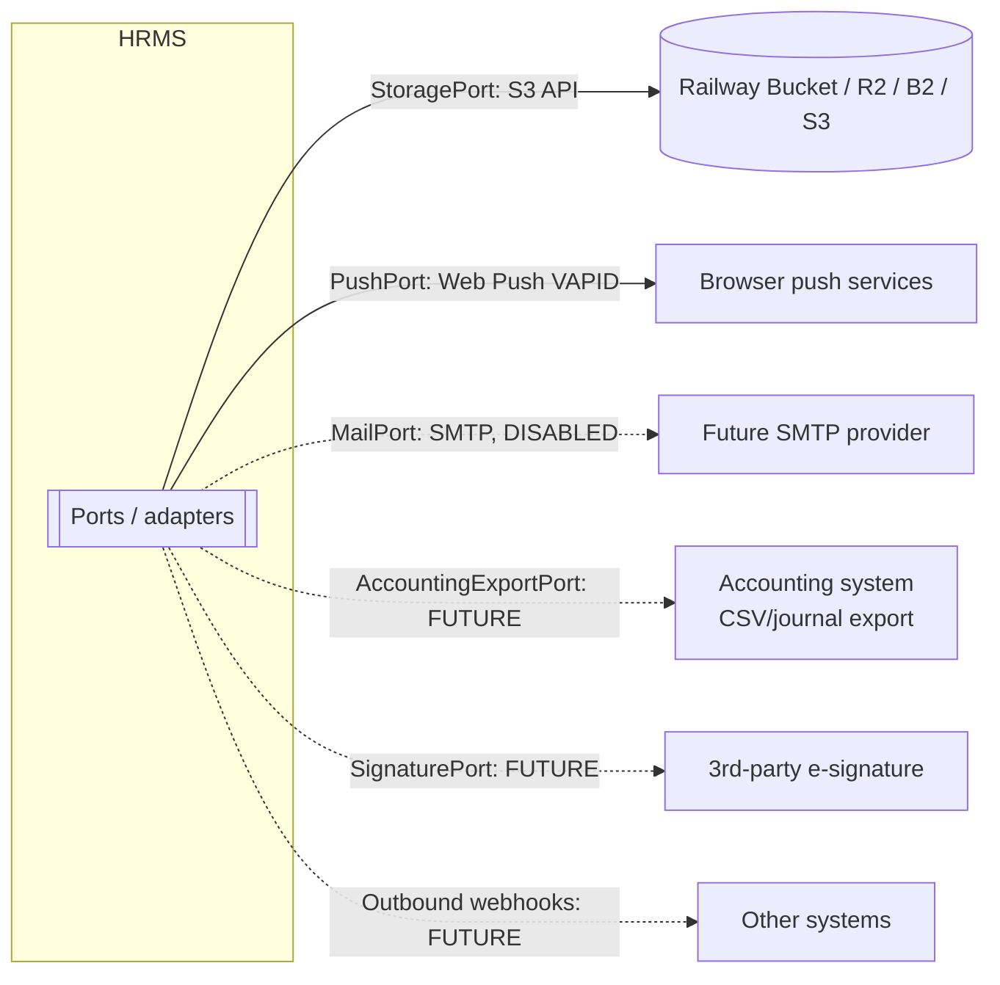

# API & Integration Proposal

Status: **Proposed** (D-18).

## 1. Principles

- **REST + JSON**, base path `/api/v1`. The browser PWA and a future native app use the same API (ARC-03).
- **Contract-first in code:** zod schemas → generated **OpenAPI 3.1** (`/api/v1/openapi.json`, only for authenticated admins outside development).
- Errors follow RFC 9457 `application/problem+json` with stable `code` values and localisable messages.
- Pagination: cursor-based (`?cursor=&limit=`). Filtering: `?filter[field]=`. Sorting: `?sort=-hire_date`.
- `Idempotency-Key` header on punches, approvals, payroll actions and uploads.
- `ETag`/`If-Match` (row `version`) for optimistic concurrency.
- Browser authentication: session cookie (HttpOnly, Secure, SameSite=Lax) plus a CSRF token header for state-changing requests.
- Future native/integration clients: OAuth 2.1-style tokens or scoped API keys. **Not built initially**; the design keeps auth behind an adapter.

## 2. Resource map (indicative)

| Area | Endpoints (examples) |
|---|---|
| Auth | `POST /auth/login`, `POST /auth/logout`, `POST /auth/mfa/verify`, `POST /auth/webauthn/{register,authenticate}/{options,verify}`, `POST /auth/pin/unlock`, `GET/DELETE /me/sessions/{id}` |
| Org | `GET/POST /companies`, `/companies/{id}/departments`, `/companies/{id}/work-locations`, `/work-locations/{id}/network-ranges` |
| Access | `/roles`, `/roles/{id}/permissions`, `/users/{id}/role-assignments`, `/permissions` |
| Settings | `GET/PUT /settings/{area}?companyId=`, `/modules`, `/modules/{key}/companies/{id}` |
| Employees | `/employees`, `/employees/{id}`, `/employees/{id}/assignments`, `/employees/{id}/compensation`, `/employees/{id}/bank-accounts`, `/employees/{id}/qualifications`, `/employees/{id}/lifecycle-events`, `POST /employees/{id}/transfer` |
| Documents | `POST /documents/upload-intents` → presigned PUT; `POST /documents` (finalize); `GET /documents/{id}/download-url` |
| Calendar | `/schedules`, `/schedule-assignments`, `/holiday-calendars/{id}/holidays` |
| Attendance | `POST /attendance/punches`, `GET /attendance/days?employeeId=&from=&to=`, `/attendance/corrections`, `/attendance/devices`, `/attendance/absence-review` |
| Leave | `/leave/types`, `/leave/requests`, `/leave/balances?employeeId=`, `/leave/permissions` (in-day) |
| Workflow | `GET /tasks/mine`, `POST /tasks/{id}/decision`, `/delegations` |
| Payroll | `/payroll/periods`, `/payroll/runs`, `POST /payroll/runs/{id}/{calculate,submit,approve,reject,reopen}`, `/payroll/runs/{id}/items`, `/payroll/payslips/mine`, `/payroll/payments` |
| Contracts | `/contracts`, `/contracts/{id}/versions`, `POST /contracts/{id}/{sign,renew,addendum}`, `/contract-templates` |
| Recruitment | `/vacancies`, `/candidates`, `/applications/{id}/{interviews,offer,convert}` |
| Separation | `/separations`, `POST /separations/{id}/{approve,cancel}`, `POST /employees/{id}/rehire` |
| Evaluation | `/evaluation/policies`, `/evaluation/results` |
| Reports | `/reports/datasets`, `/reports/saved`, `POST /reports/run`, `POST /reports/export?format=xlsx|pdf`, `/reports/schedules` |
| Search | `GET /search?q=&types=` |
| Notifications | `/notifications`, `POST /notifications/read-all`, `/push-subscriptions` |
| Audit | `GET /audit-events` |
| Ops | `GET /health/live`, `GET /health/ready` (DB + storage reachability, no secrets) |

## 3. Integrations

| Integration | Initial status | Notes |
|---|---|---|
| Object storage | **Active** (after Q-19) | S3 API. Provider is selected by environment variables |
| Web Push | Active | VAPID keys in Railway secrets. Free |
| SMTP | **Prepared, disabled** (NOT-05) | `MAIL_ENABLED=false`. Adapter implemented with a "log only" sink. Activation steps documented |
| Accounting | Future (PAY-09) | Export file format defined later |
| Third-party e-signature | Future (Q-14) | Port defined, no implementation |
| SMS / WhatsApp | **Excluded** | — |

## 4. Versioning & compatibility

- Additive changes are allowed within `/v1`. Breaking changes require `/v2` and a deprecation notice period (important once a native app exists).
- The OpenAPI snapshot is committed. CI fails when the snapshot changes unexpectedly (contract drift).
