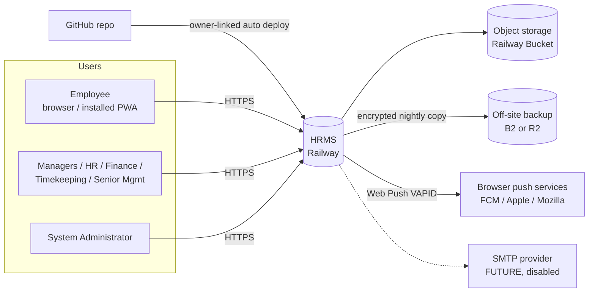
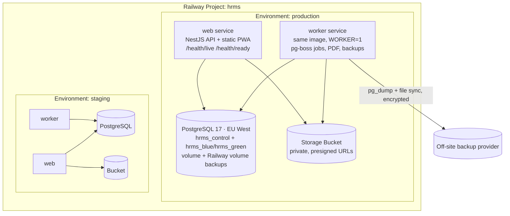
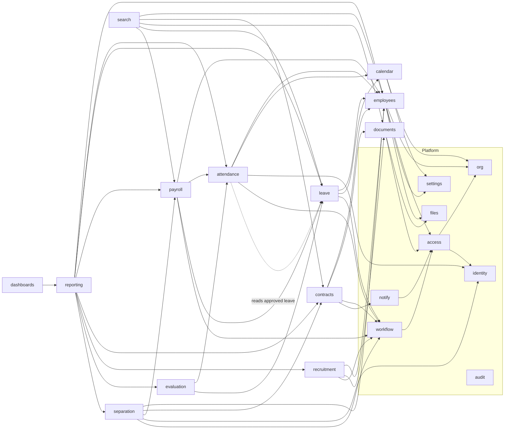
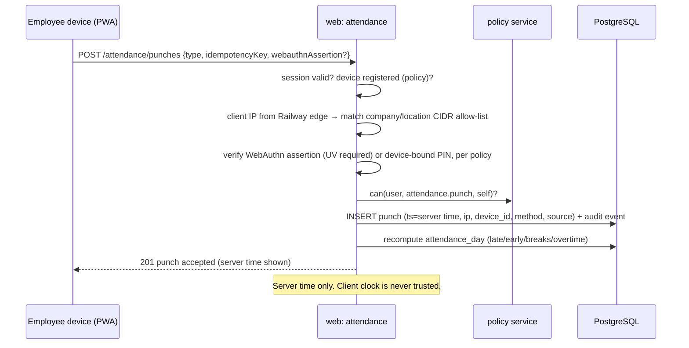
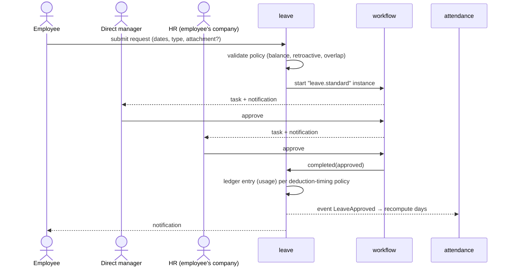
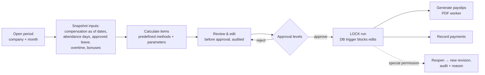
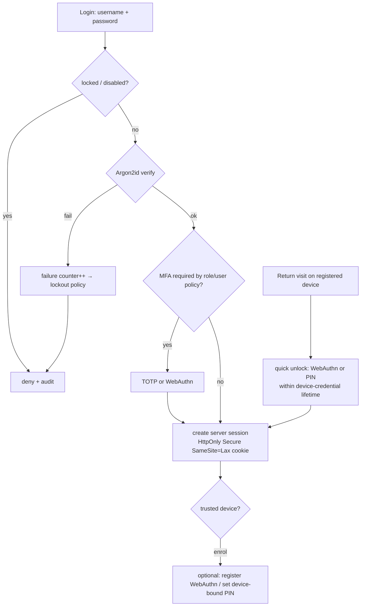

# Proposed Architecture

Status: **Proposed (awaiting approval)**. Everything here is a recommendation, not a verified fact about existing code (there is none).

## 1. Drivers

1. Data integrity and auditability (payroll, leave balances, contracts, history).
2. Strict company isolation and fine-grained authorization.
3. Arabic RTL / English LTR as equals.
4. Low operating cost and low operational complexity on Railway.
5. Maintainability by a small team. Configurable but testable behaviour.
6. Future native mobile app and integrations through the same API.

## 2. System context

## 3. Technology recommendation

### 3.1 Options compared

| Criterion | **A. TypeScript: NestJS + React** (recommended) | B. Python: Django/DRF + React | C. .NET: ASP.NET Core + React | D. Next.js full-stack |
|---|---|---|---|---|
| One language front + back | ✅ | ❌ (Python + TS) | ❌ (C# + TS) | ✅ |
| Structure for a large modular back end | ✅ modules, DI, guards | ✅ apps, very mature | ✅ excellent | ⚠️ server actions/routes blur boundaries |
| Built-in admin/auth | ⚠️ build it | ✅ Django admin & auth | ⚠️ Identity | ⚠️ |
| Decimal money handling | ⚠️ needs decimal.js discipline | ✅ `Decimal` native | ✅ `decimal` native | ⚠️ |
| Background jobs without Redis | ✅ pg-boss | ⚠️ Celery usually needs Redis (paid service) | ✅ Hangfire/Postgres | ✅ pg-boss |
| Railway fit | ✅ | ✅ | ✅ | ✅ |
| Hiring/maintenance pool | ✅ large | ✅ large | ✅ | ✅ |
| Shared validation schemas between UI and API | ✅ zod shared package | ❌ | ❌ | ✅ |

**Recommendation: Option A**, unless the long-term maintainers are Python or .NET developers (Q-03). In that case choose B or C. The architecture below does not depend on the language.

### 3.2 Proposed stack (Option A)

| Layer | Choice | Reason |
|---|---|---|
| Runtime | Node.js 24 LTS | Already installed locally. LTS support |
| API | NestJS 11, REST, OpenAPI generated | Module boundaries, guards/interceptors for authz and audit |
| Validation | zod (shared package) | Same schemas in the UI and the API |
| DB access | Drizzle ORM + reviewed SQL migrations (drizzle-kit) | Plain SQL migrations are reviewable. Easy to set RLS session variables per transaction |
| Database | PostgreSQL 17 (Railway) | `numeric`, exclusion constraints (`btree_gist`), RLS, JSONB, full-text search |
| Jobs/scheduler | pg-boss (Postgres-backed) | Absence detection, accruals, alerts, report schedules, backups. No Redis cost |
| Front end | React 19 + Vite + TypeScript, TanStack Router + Query | SPA/PWA. Static build served by the API service |
| UI kit | Mantine 8 (+ mantine-datatable) | Native RTL, accessible components, theming for the white/blue palette |
| i18n | i18next, ICU messages; `dir` switch at the root | Two languages |
| PWA/Push | vite-plugin-pwa (Workbox), Web Push with VAPID | Free. iOS needs the PWA installed (iOS ≥ 16.4) |
| Auth | Argon2id, server-side sessions, @simplewebauthn, otplib (TOTP) | D-07, D-09 |
| Files | AWS SDK v3 S3 client behind a `StoragePort` interface | Provider-agnostic (D-05) |
| PDF | Playwright headless Chromium (worker) | Correct Arabic shaping (D-08) |
| Excel | exceljs | Export with RTL sheet support |
| Testing | Vitest, Supertest, Playwright E2E. PGlite locally, real PostgreSQL 17 in CI (D-19) | See testing-strategy.md |
| Package manager | **npm workspaces** (npm already installed. No global installs, Q-25) | D-12 revised |
| Backup/restore | `pg_dump`/`pg_restore` (PostgreSQL 17 client in the worker image), control DB + blue/green data slots | D-16b, backup-recovery.md |
| Quality | ESLint, Prettier, TypeScript strict, gitleaks, OSV-Scanner/npm audit, Semgrep | Static and dependency checks in CI |
| CI | GitHub Actions | Railway "wait for CI" before deploy (to verify in Phase 1) |

## 4. Runtime topology (modular monolith)

- **Database slots (D-16b):** the app reads which data database is active (`hrms_blue` or `hrms_green`) from the small `hrms_control` database at startup and when a restore switch is signalled. Restores load into the inactive slot. See [backup-recovery.md §3](../08-operations/backup-recovery.md#3-in-app-restore--design).
- **One codebase, one Docker image, two start commands.** The web service handles HTTP. The worker runs scheduled and long-running jobs, so a slow PDF never blocks a punch.
- Communication between modules happens through in-process service interfaces and **domain events** (outbox table → pg-boss). That keeps modules decoupled so one could be extracted later.
- The PWA is built at deploy time and served by the web service from the same origin. That avoids CORS and keeps cookies first-party.

## 5. Module map and dependencies

### 5.1 Modules

| Layer | Module | Owns |
|---|---|---|
| Platform | **identity** | users, credentials, sessions, devices, MFA, WebAuthn, PIN |
| Platform | **access** | roles, permissions, role assignments, scope resolution, policy service |
| Platform | **org** | group, companies, departments, work locations, network allow-lists |
| Platform | **settings** | typed settings (group + company overrides), module registry/enablement |
| Platform | **audit** | append-only audit events, audit queries |
| Platform | **workflow** | approval definitions, instances, tasks, delegation |
| Platform | **notify** | notification centre, push subscriptions, SMTP adapter (disabled) |
| Platform | **files** | storage port, upload scanning/validation, encryption |
| HR core | **employees** | employee identity, numbering, assignments, compensation, bank, qualifications, lifecycle events |
| HR core | **documents** | categories, metadata, document links |
| Time | **calendar** | work schedules, schedule assignments, holiday calendars |
| Time | **attendance** | punches, attendance days, breaks, corrections, absence detection |
| Time | **leave** | leave types/policies, ledger, leave requests, in-day permissions |
| Pay | **payroll** | pay components, runs, items, payslips, payments, settlements |
| HR process | **contracts** | types, templates, clauses, contracts, versions, signatures, alerts |
| HR process | **recruitment** | vacancies, candidates, applications, interviews, offers |
| HR process | **separation** | termination cases, rehire |
| Analytics | **evaluation** | commitment-evaluation policies and results |
| Analytics | **reporting** | datasets, saved reports, exports, schedules |
| Analytics | **search** | global search index/queries |
| Analytics | **dashboards** | widget catalogue, role/company layouts |

### 5.2 Dependency graph (arrows = "depends on")

Rules:
- Platform modules never depend on business modules.
- `audit` is called by everything through an interceptor and domain events, so it is not drawn.
- The attendance ↔ leave cycle is broken with events: leave publishes `LeaveApproved/Cancelled`, and attendance recomputes the affected days. Attendance only *reads* leave through a query interface.
- Reporting and search are read-only consumers.

## 6. Key data flows

### 6.1 Attendance punch

### 6.2 Leave approval (seeded locked chain, CF-06)

### 6.3 Monthly payroll

Inputs are **snapshotted** into the run, so recalculation is reproducible and later changes to attendance never alter a locked run silently.

## 7. Cross-cutting design

- **Configuration (D-10):** each setting has a typed schema, a default, scope (group/company), a permission and an audit trail. Calculation behaviour is chosen from enumerated methods with parameters. Every method has unit tests.
- **Effective dating (D-04):** "as of" queries (`valid_from <= d < valid_to`) for assignments, compensation and schedules. Transfers and promotions are new rows, never updates of old ones.
- **Idempotency:** punches, payroll actions and approvals accept an `Idempotency-Key`, so double taps on mobile are safe.
- **Optimistic concurrency:** a `version` column, with `If-Match` checked on updates.
- **Time:** timestamps are UTC `timestamptz`. The "work date" is derived in the configured group timezone. The server clock is authoritative.
- **Money:** `numeric(18,4)` in the DB and decimal.js in code. Rounding rules are configurable per currency (minor units).
- **Domain events + outbox:** state changes write an outbox row in the same transaction. The worker dispatches it to notifications, recomputations and search indexing.
- **Module enablement:** a guard rejects calls to disabled modules according to the module's disable policy (C-13). Data is never deleted.

## 8. Authentication flow (summary)

The full authorization decision flow is in [authorization-model.md](authorization-model.md).

## 9. Known limitations (to carry into user documentation)

1. IP-based attendance restriction does not prove physical presence (ATT-08).
2. WebAuthn proves a registered device was unlocked by its user verification. That may be a device PIN rather than a fingerprint (C-15).
3. Auto check-out is administrative, not evidence of departure (ATT-11).
4. Web Push on iOS works only for PWAs installed to the home screen. Delivery is best-effort.
5. A single Railway region means a region-wide outage makes the system unavailable until it recovers or is restored elsewhere (see backup-recovery.md).
