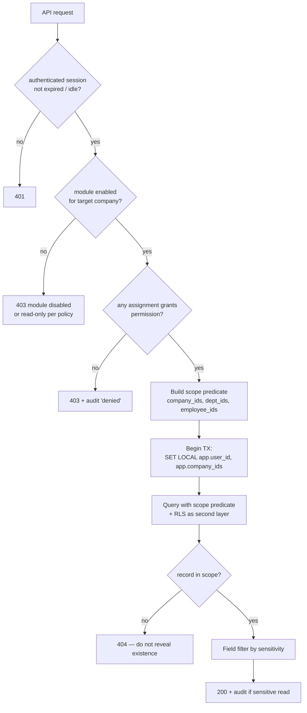

# Authorization & Company-Isolation Model

Status: **Proposed**. Covers RBAC-01 to RBAC-07, ORG-02, ORG-04, EMP-09, EMP-10, RPT-05 and SRCH-02.

## 1. Concepts

| Concept | Definition |
|---|---|
| **Permission** | `module.resource.action`, for example `payroll.payslip.view`, `employee.financial.view`, `leave.request.approve`. Each permission has a **sensitivity** class: `normal`, `personal`, `financial`, `identity`, `medical`, `security` |
| **Role** | A named set of permissions. Seeded system roles can be copied but not deleted. The admin creates custom roles (RBAC-02) |
| **Scope** | Where a role assignment applies: `GROUP` · `COMPANY(id)` · `DEPARTMENT(id, includeSub?)` · `DIRECT_REPORTS` · `SELF` |
| **Role assignment** | (user, role, scope, valid_from, valid_to). A user can hold several assignments |
| **Effective access** | The union of all active assignments. **Default deny** |

Rules:
1. A request is allowed only if some active assignment grants the permission **and** the target record falls inside that assignment's scope.
2. Scope is resolved against the record's **owning company/department at the relevant date**. For employee records, that is the current assignment. For historical items (for example an old payroll item), it is the company that owned the item.
3. `SELF` scope means `record.employee_id = user.employee_id`.
4. Sensitive fields are filtered at serialization. Without `employee.financial.view`, salary and bank fields are **omitted from responses**, not just hidden in the UI.

## 2. Decision flow



**Two layers:**
1. **Application policy service.** Explicit checks in guards plus scope predicates injected into every repository query.
2. **PostgreSQL RLS.** Each company-scoped table has a policy `company_id = ANY(current_setting('app.company_ids')::uuid[])`. The app connects as a non-owner role without `BYPASSRLS`. If a developer forgets a filter, RLS still blocks cross-company rows. Migrations and the worker's group-wide jobs use separate roles with explicit, audited elevation.

## 3. Seeded roles and default scopes (proposed defaults, all editable)

| Role | Default scope | Key permissions (summary) |
|---|---|---|
| System Administrator | GROUP | Settings, modules, roles, accounts, audit access, security policies. **Not** automatically payroll approver or sensitive-data viewer (separation of duties). Granted explicitly if desired |
| HR Employee | COMPANY (assigned companies) | Employees CRUD, lifecycle, documents, contracts, leave (HR step), attendance review/corrections, recruitment, termination, `employee.financial.view` |
| Senior Management | GROUP (Q-21) | Read most modules, group summaries, approvals where configured, `employee.financial.view` |
| Company Manager | COMPANY | Read company employees, approve company-level workflows, dashboards, reports |
| Department Manager | DEPARTMENT | Read department employees (non-sensitive), approve leave/corrections for department members, reports |
| (relationship) Direct Manager | DIRECT_REPORTS (derived from assignments, no explicit role needed) | Approve leave step 1 and permissions, view direct reports' attendance |
| Employee | SELF | Own profile (view, limited edit), own attendance punch/history, own leave requests/balance, own payslips, own current salary, own contracts/documents per config |
| Accountant / Finance | COMPANY | Payroll prepare/view/export, payments, `employee.financial.view`. Approval levels configurable |
| Attendance / Timekeeping Officer | COMPANY | Attendance view, corrections, schedules assignment, devices, absence review. No financial data |

**Separation of duties (recommended, configurable):** the payroll preparer cannot approve the same run. A user cannot approve their own leave, correction, contract or termination. An admin cannot grant permissions to themself without a second admin when "dual control" is enabled.

## 4. Special rules

| Situation | Rule |
|---|---|
| Employee transferred A → B | Company A users lose access to *new* records. Access to company A's *historical* records (old payroll items, old attendance) remains with company A's HR/Finance, because those records keep `company_id = A`. Company B HR sees the profile, plus history only with the permission `employee.history.crosscompany.view` |
| Manager in another company (Q-16) | The `DIRECT_REPORTS` relationship grants approval of the report's leave only, not general company access |
| Payslips | `SELF` employees only for their own items. Any other access needs `payroll.payslip.view` in the item's company |
| Files | Download URLs are **short-lived (≤ 5 min) presigned URLs**, issued only after the same authorization check as the parent record. Object keys are random UUIDs and never guessable |
| Search, reports, exports | Execute through the same repositories and scope predicates. Exports are audited with the row count and filters |
| Notifications | A notification is created per recipient after an authorization check at creation, and **again when it is opened** (access may have been revoked) |
| Audit log | `audit.view` scoped by company. `audit.view.security` for authentication events. Viewing audit is itself audited (AUD-03) |
| Terminated users | Sessions are revoked, assignments end on the last working day, and devices are revoked, per TRM-05 policy |

## 5. Permission catalogue (structure)

```
org.company.{view,create,edit}            settings.{view,manage}.<area>
access.role.{view,manage}                 access.assignment.manage
identity.user.{view,create,edit,disable}  identity.session.{view,revoke}
employee.profile.{view,create,edit}       employee.financial.{view,edit}
employee.identity.view                    employee.lifecycle.{create,approve}
documents.<category>.{view,upload,delete,restore}
attendance.punch (self)                   attendance.record.{view,correct}
attendance.correction.{request,approve}   attendance.device.{view,manage}
leave.request.{create,view,approve,cancel} leave.balance.{view,adjust}
payroll.run.{view,prepare,approve,reopen,export} payroll.payslip.view
payroll.payment.{view,record}             contracts.contract.{view,create,sign,renew}
recruitment.*                             separation.case.{initiate,approve,cancel}
evaluation.result.{view,recalculate}      reports.{run,export,schedule,manage}
dashboards.manage                         audit.{view,view.security,export}
```

The full catalogue is generated from code (a single source of truth), exported to `docs/03-architecture/permissions.generated.md` in CI and checked for drift.

## 6. Testing the model (RBAC-07, QA-02)

- **Declarative authorization matrix** (`authz-matrix.yaml`): endpoint × persona × target → `allow | deny(403) | notfound(404)`. A test generator runs every cell against seeded data in CI.
- Mandatory negative cases include: employee → another employee's payslip; company-A manager → company-B employee; department manager → salary fields; HR(A) → export of company B; terminated user → any endpoint; expired role assignment; disabled module; presigned URL reuse after expiry; search leaking titles from another company.
- **RLS tests:** connect as the app role with `app.company_ids = {A}` and assert that raw `SELECT`s on every company-scoped table return zero rows from B. A CI check fails if a company-scoped table **has no RLS policy**.
