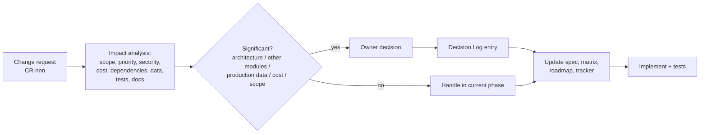

# Git & Change-Management Approach

Status: **Proposed.** Covers GOV-04, GOV-05 and ARC-02.

## 1. Repository setup (first step of Phase 1, after approval)

1. `git init` in the project folder, default branch `main`.
2. Add `.gitignore` **before the first commit**: `.env*` (except `.env.example`), `node_modules/`, `dist/`, `coverage/`, `*.dump`, `*.sql.gz`, `uploads/`, `.DS_Store`, IDE folders.
3. First commit: `docs/` only (this package) → tag `planning-v0.1`.
4. **The owner** creates the GitHub repository (private), adds the remote and pushes, then links GitHub ↔ Railway. I do not perform any account operations.
5. Recommended GitHub settings (owner): branch protection on `main` and `production` (PR required, CI green required, no force-push), secret scanning, Dependabot alerts.

## 2. Branching & environments

| Branch | Purpose | Railway |
|---|---|---|
| `main` | Integrated, CI-green work | Auto-deploys to **staging** |
| `production` | What runs in production | Auto-deploys to **production** — updated only by an approved fast-forward from `main` (release) |
| `feature/P<n>-<short-name>` | Short-lived work branches | None (optionally PR environments later) |
| `hotfix/<issue>` | Urgent production fix, merged to `production` and back to `main` | — |

Recovery points: annotated tags per release (`v1.4.0`) and per approved phase (`phase-2-accepted`), plus a database backup before each production migration.

## 3. Commits, PRs, versions

- Conventional Commits (`feat(attendance): …`, `fix(payroll): …`). Requirement IDs referenced in PR descriptions.
- PR template: scope, requirement IDs, migration? (yes/no + destructive?), security impact, screenshots AR/EN, tests added, docs updated.
- Semantic versioning. `CHANGELOG.md` generated from commits.
- The PR is merged only with CI green and review approval (self-review checklist if the team is one person).

## 4. Change-management process (new or changed requirements)

- Change requests are recorded as GitHub Issues labelled `change-request`, with the template: description, reason, impact analysis, recommendation.
- **Ordinary defects** inside the current phase are fixed, tested and noted in the PR without owner approval, unless they affect other modules, production data, architecture or scope.
- Never: overwrite or delete user work, force-push to protected branches, or run destructive migrations without explicit approval.
