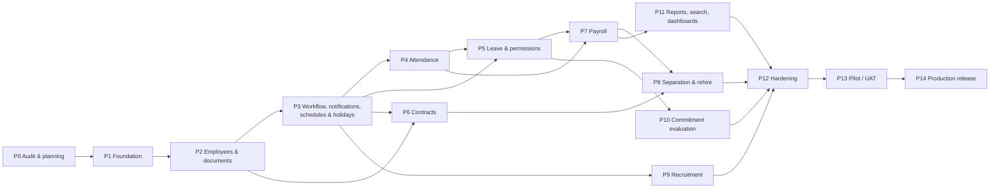

# Phased Implementation Roadmap & Acceptance Criteria

Status: **Proposed.** Each phase ends at an **approval gate**: the shared criteria in [testing-strategy.md §5](../06-quality/testing-strategy.md#5-phase-acceptance-gate-applies-to-every-phase) **plus** the phase-specific criteria below. The next phase does not start without the owner's approval.

Durations are not estimated. They depend on team size and on answers to Q-02/Q-03. They will be added once those are known rather than invented now.

---

## P0 — Audit & planning *(current)*
**Objective:** this package. **Gate:** owner approves the D-decisions and answers the blocking questions. Answered on 2026-10-10: Q-01 (EU), Q-02, Q-03, Q-10, Q-12, Q-20 (deferred), Q-21, Q-25. **Still needed for the P1 start:** Q-29 (D-19 testing approach) and approval of the remaining proposed decisions.

## P1 — Foundation platform
**Scope:** `git init`, `.gitignore`, monorepo, CI; NestJS/React skeletons; i18n shell (AR RTL / EN LTR) with the app shell and collapsible sidebar; org (group, companies, departments, work locations); identity (password login, Argon2id, lockout, server sessions, idle/absolute timeout, session list/revoke); TOTP MFA; access (permissions, roles, assignments, scopes, policy service, RLS); settings framework + module registry; audit (append-only, hash chain); health checks; Railway staging deploy in **EU West** (owner links GitHub); control DB + blue/green slot layout; nightly encrypted backups to off-site EU storage; first operator **restore drill**. Spikes: PGlite parity (D-19); Railway PostgreSQL allows extra databases and roles.
**Dependencies:** D-01 ✅, D-02, D-03, D-07, D-12, D-13, D-15, D-16b ✅, D-19 approved; Railway workspace (owner); off-site backup provider approved (Q-19).
**Risks:** no local database server, so the feedback loop depends on CI (mitigated by PGlite); RLS performance → measured early.
**Acceptance criteria:**
1. A user logs in, is locked out after the configured failures, and can see and revoke their sessions. Idle timeout works.
2. Admin creates companies/departments, custom roles and scoped assignments. Every change is audited with before/after values.
3. The authorization matrix and RLS tests run in CI. A company-scoped table without a policy fails CI.
4. Audit rows cannot be updated or deleted by the app role (test). Hash-chain verification job passes.
5. UI switches between AR (RTL) and EN (LTR) via the global setting. axe shows no critical violations on the shell.
6. Staging deploy via GitHub → Railway. `/health/ready` is green. A migration runs in pre-deploy. Rollback rehearsed once.
7. A backup was taken **and restored** into a scratch database with verified row counts.

## P2 — Employees & documents
**Scope:** employee profile (EMP-01 to EMP-04, EMP-11), employee numbering (C-01), effective-dated assignments/compensation, bank accounts (encrypted), qualifications, lifecycle events (hire, probation/confirmation, transfer, title/manager change, promotion, salary change, suspension/long leave), user↔employee linking, documents module + storage adapter + encryption. (No data import: the system starts empty, DL-013.)
**Dependencies:** Q-05, Q-06, Q-16, Q-19 (storage approval), Q-26.
**Acceptance criteria:**
1. Transfer between companies keeps the employee number. History shows both assignments. Old-company access rules are respected (authz tests).
2. Salary/bank fields never appear in API responses without `employee.financial.view` (negative tests NEG-03).
3. National ID duplicate detection works through the blind index. Values are encrypted in the DB (checked by a raw SQL test).
4. Document upload enforces type/size/magic bytes. Downloads use short-lived URLs. Replace/delete/restore follow the category policy.
5. Overlapping assignments are rejected by the DB.

## P3 — Workflow engine, notifications, schedules & holidays
**Scope:** generic approval engine (D-17) with delegation; notification centre; Web Push; SMTP adapter (disabled, log-only); work schedules and effective-dated assignments; group/company holiday calendars; **System Administrator backup dashboard with in-app restore (BKP-06, D-16b)** and monthly automated dry-run restore.
**Dependencies:** Q-07, Q-08, Q-15, Q-28 (timezone, C-19).
**Acceptance criteria:** a workflow routes by relationship and role, delegates, and records every decision; self-approval is blocked; notifications re-check authorization on open; push works on Chrome/Edge/Android and on installed iOS PWA; schedule history queries "as of" a date correctly; no email is sent (asserted). **Restore on staging:** the preview shows the correct loss counts; MFA is required; a failed check leaves production untouched; switch + undo work; audit events after the backup survive the restore; non-admins and custom roles cannot restore (authz tests).

## P4 — Attendance
**Scope:** punch API/UI, IP allow-lists per location, **spike: verify that the Railway client-IP header cannot be spoofed**, WebAuthn platform authenticators, device registration and approval, device-bound PIN, breaks, attendance-day computation, overtime, holiday classification, administrative auto-closure, absence detection job, corrections workflow, review queue.
**Dependencies:** Q-04 (custom domain **before** biometric enrolment), Q-09, Q-17; golden-case table signed off by HR.
**Acceptance criteria:** all golden cases pass; NEG-06 and NEG-14 pass; auto-closed days produce no overtime (C-02); holiday work is not overtime; absence detection respects approved leave and holidays; corrections keep the original punches; punch p95 < 1 s under a k6 burst test.

## P5 — Leave & in-day permissions
**Scope:** leave types/policies, ledger, accrual/carryover/expiry jobs, requests with the locked chain (C-05), in-day permissions, attachments (medical category, C-12), cancellation, retroactive and over-balance policies, integration events with attendance.
**Acceptance criteria:** ledger sum equals the displayed balance (property test); golden cases (mid-year hire, carryover cap, cancellation) pass; approved leave converts potential absence into leave days; managers cannot open medical attachments.

## P6 — Contracts
**Scope:** types, templates, clauses, merge fields, generation (AR/EN, Q-22), signing (Q-14) and upload of signed copies, immutability, versions/addenda, renewals (manual/auto per type), expiry & probation alerts, policies for expiry during leave.
**Acceptance criteria:** a signed version cannot be modified (API + DB tests); renewal creates history in the configured mode; alerts fire with the configured timing, count and recipients; Arabic PDF renders correctly (visual check signed off).

## P7 — Payroll
**Scope:** pay components with predefined methods (D-10), periods, runs per company, input snapshots, calculation with explanations, edit before approval, multi-level approval, lock, reopen as a revision, payslips (PDF), payments, multi-currency totals (Q-13), end-of-service settlement method (Q-01), group summaries.
**Dependencies:** Q-13, Q-24, Q-01, plus HR/Finance golden cases.
**Acceptance criteria:** golden cases pass to the minor currency unit; NEG-01/NEG-07 pass; a locked run is reproducible from its snapshot; reopen keeps the previous revision and audit reason; preparer ≠ approver enforced when enabled; performance target met for the largest company.

## P8 — Separation & rehire
**Scope:** termination types and workflows, last working day, settlement integration, cancellation, exit access policy (TRM-05), rehire with the same number.
**Acceptance criteria:** after the last working day the account is disabled, sessions revoked and devices revoked per policy (NEG-05); history is intact; rehire creates a new assignment with the same employee number.

## P9 — Recruitment
**Scope:** vacancies, candidates, CV upload, statuses, screening, interviews, notes, offers, conversion to employee. A public portal only if Q-11 says so.
**Acceptance criteria:** conversion pre-fills an employee record without duplicate creation; candidate documents follow the recruitment category policies; no hardcoded mandatory documents.

## P10 — Commitment evaluation
**Scope:** policies (periods, weights, rules), calculation and recalculation, visibility, optional salary-impact link to payroll.
**Acceptance criteria:** scores reproduce from inputs; recalculation is audited; **no performance-appraisal features exist** (exclusion check).

## P11 — Reports, search, dashboards
**Scope:** curated datasets with field sensitivity, report builder, saved reports, Excel/PDF export, print, scheduled reports (in-app delivery, C-03), global search, dashboard widget catalogue and layouts.
**Acceptance criteria:** NEG-04/NEG-11 pass; exports are audited and formula-injection-safe; scheduled reports deliver to the notification centre.

## P12 — Hardening
**Scope:** ASVS L2 review, ZAP scan, manual authorization testing, performance tests, accessibility pass, backup/restore drill, runbooks, admin and user guides (AR/EN).
**Acceptance criteria:** zero open critical/high findings; restore drill meets RPO/RTO; documentation complete.

## P13 — Pilot / UAT
See [pilot-uat-plan.md](../06-quality/pilot-uat-plan.md). **Gate:** UAT sign-off, **retention periods approved (C-20)**, owner confirms the GDPR items (DPAs signed, DPIA done, legal review of §10 items in the security plan).

## P14 — Production release
**Gate:** explicit owner approval for production deployment and any paid plan changes; release checklist in [railway-deployment.md](../08-operations/railway-deployment.md).
